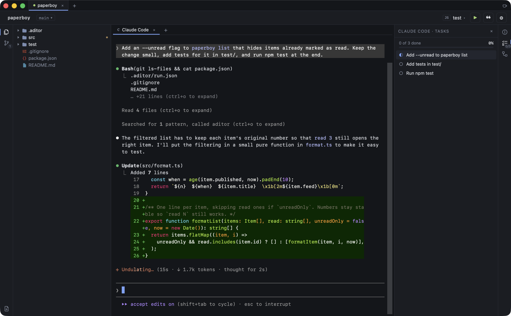

<h1 align="center">
  <br>
  Aditor
</h1>

<p align="center">
  <b>Where AI agents are first-class.</b><br>
  A lightweight editor with your coding agent in the main pane.<br>
  <sub>macOS · Windows · Linux · <a href="https://aditor.dev">aditor.dev</a> · <a href="LICENSE">GPL-3.0</a></sub>
</p>

<p align="center">
  <a href="https://github.com/lazap/aditor/actions/workflows/ci.yml"></a>
  <a href="https://github.com/lazap/aditor/releases/latest"></a>
</p>

<p align="center">
  
</p>

Aditor runs your agent in a real terminal and puts what you reach for while it
works around it: the file tree, diffs, git, your dev server's output, and the
agent's own task list.

## Install

You need the [`claude` CLI](https://claude.com/claude-code) on your `PATH`.
Every build updates itself once installed.

**macOS** (Apple Silicon):

```bash
brew tap lazap/aditor
brew install --cask aditor
```

Or download the `.dmg` from [Releases](https://github.com/lazap/aditor/releases).
Builds aren't notarized, so a downloaded copy needs **Open Anyway** in System
Settings › Privacy & Security on first launch, or
`xattr -dr com.apple.quarantine /Applications/Aditor.app` (Homebrew handles this for you).

**Windows** (x64): run `Aditor_<version>_x64-setup.exe` from
[Releases](https://github.com/lazap/aditor/releases). It installs for your user,
without an administrator prompt. The installer isn't code-signed, so SmartScreen
stops it the first time: **More info**, then **Run anyway**.

**Linux** (x64, WebKitGTK 4.1: Ubuntu 22.04, Debian 12, Fedora 36 or newer):
the `.AppImage` from [Releases](https://github.com/lazap/aditor/releases) runs
anywhere once made executable, or on Debian and Ubuntu install the `.deb`:

```bash
sudo apt install ./Aditor_<version>_amd64.deb
```

Windows and Linux are newer than the Mac build and have had less use;
[reports](https://github.com/lazap/aditor/issues) are welcome.

## Features

- **Real terminal**: the agent's own TUI, your shell, your `PATH`.
- **Sessions as tabs**: several agents per project, <kbd>⌘</kbd><kbd>1</kbd>–<kbd>⌘</kbd><kbd>9</kbd> (<kbd>Ctrl</kbd> on Windows and Linux).
- **Worktrees**: start a session on its own branch.
- **Live task list**: the agent's plan, ticked off as it works.
- **Questions and review**: the agent asks with real buttons and hands you diffs to approve.
- **Reads your runs**: dev server and test output, no pasting.
- **Git**: stage, commit, pull, push, log and blame, through your own `git`.
- **Diffs**: unified or side by side.
- **Clickable paths**: `src/a.ts:42` in the agent's output opens at that line.
- **Prompt templates**: <kbd>⌘</kbd><kbd>⇧</kbd><kbd>P</kbd>, with placeholders for the open file, branch and more.
- **Notifications**: a dot, a banner and a Dock badge (a taskbar dot on Windows) when it's your turn.
- **Usage and cost**: tokens, cost and limits per session, plus an account switcher.

Works with **Claude Code** and **opencode**. Tasks, review, history and limits
are Claude Code only for now.

Shortcuts and the full list of agent tools are on the
[reference page](https://aditor.dev/reference/). On Windows and Linux the agent
keeps every <kbd>Ctrl</kbd>+letter for itself, so Aditor's own shortcuts there
use <kbd>Ctrl</kbd><kbd>Shift</kbd>, and the terminal copies and pastes with
<kbd>Ctrl</kbd><kbd>Shift</kbd><kbd>C</kbd> and <kbd>Ctrl</kbd><kbd>Shift</kbd><kbd>V</kbd>;
Settings › Shortcuts lists them all. Settings live in
`~/.aditor/settings.json`.

## Build from source

```bash
git clone https://github.com/lazap/aditor.git
cd aditor
npm install
npm start
```

Needs Node 22+ and Rust, plus the Xcode Command Line Tools on macOS or
WebKitGTK on Linux (see [CONTRIBUTING.md](CONTRIBUTING.md#requirements)). Use
`npm start`, not `npm run dev`: `dev` starts Vite alone, with no Tauri backend
behind it.

Toolchain details, troubleshooting and a map of the source are in
[CONTRIBUTING.md](CONTRIBUTING.md).

## Contributing

Bug reports, ideas and patches are welcome. See [CONTRIBUTING.md](CONTRIBUTING.md).
Security issues go through [SECURITY.md](SECURITY.md).

## License

[GPL-3.0](LICENSE) © Lazar Petrov
