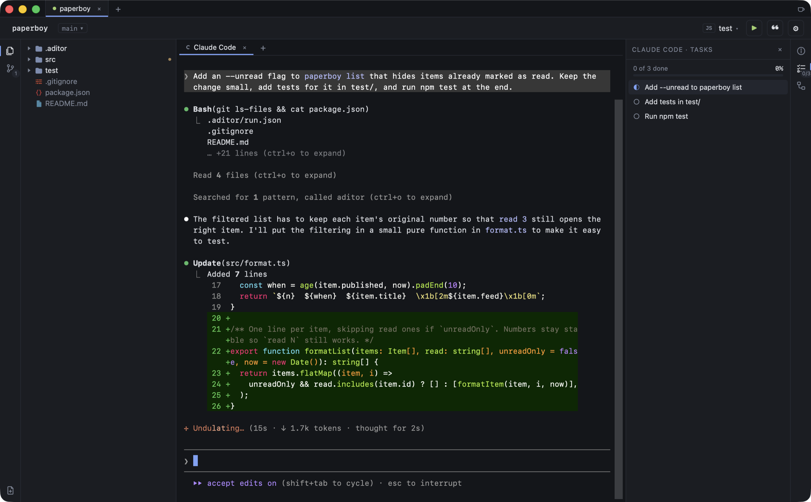

<h1 align="center">
  <br>
  Aditor
</h1>

<p align="center">
  A lightweight editor whose main pane is an agent CLI.<br>
  <sub>macOS · Apple Silicon · <a href="LICENSE">MIT</a></sub>
</p>

<!-- Drop a window shot at docs/screenshot.png (⌘⇧4 then Space, over the
     Aditor window), then delete these two comment lines to show it. -->
<!--
<p align="center">
  
</p>
-->

## What it is

Aditor wraps a coding agent running in a real PTY, and puts the things you
reach for mid-turn around it. The agent is not a sidebar here. It is the main
pane, and everything else exists to answer the questions that come up while it
works.

## Features

**The agent**

- **Claude Code in a real terminal** -- full-colour TUI, your own login shell's
  `PATH`, each agent in its own process group. opencode is detected and can be
  launched from the agent picker too.
- **Clickable file paths** -- `src/a.ts:42` printed by the agent is underlined
  on hover and opens the file at that line, tinted so you can see which one was
  meant. Toggle in **Settings → General**.
- **A live task list** -- Aditor runs a small local MCP server and hands each
  agent it spawns an `update_tasks` tool, so the agent can publish its plan and
  you can watch it tick through in the **Tasks** tab.
- **The agent can use the UI** -- the same server gives it `open_file` and
  `show_diff` to put code in front of you, `ask_user` to ask a pick-one
  question as a native prompt instead of prose, and `request_review` to have
  you approve its changes, or send it back with comments, in the diff viewer.
  Questions dock over the session that asked them; the rest of the window
  carries on.
- **Notifications** -- a session that finishes its turn or needs your input
  while you are in another tab or app gets a dot on its tab, a macOS
  notification and a count on the Dock icon. Claude Code reports its own
  status; other agents are heard through the terminal bell.
- **Prompt templates** -- the prompts you retype every day, typed into the agent
  without sending, with placeholders for the open file, branch and more. See
  [below](#prompt-templates).

**The workspace**

- **File tree**, gitignore-aware, refreshed by a filesystem watcher and
  remembering which folders you had open per project.
- **File viewer**, read-only, with syntax highlighting.
- **Diff viewer**, unified or side-by-side, for every changed file.
- **Pane or window** -- files and diffs open under the terminal, or in a window
  of their own that keeps itself current as the agent edits. Chosen separately
  for the tree and the git list.
- **Vim motions** in the viewers, opt-in: `hjkl`, `w`/`b`, `gg`/`G`,
  <kbd>Ctrl</kbd>-`d`/`u`/`f`/`b`, `/` search, and `]c`/`[c` between diff hunks.

**Git**

- **Changes list** with ahead/behind against upstream, and recently touched files
  highlighted as the agent works.
- **Stage, unstage, commit, pull (merge or rebase) and push** from the rail or
  the **Git** menu. Writes go through your own `git` binary, so credential
  helpers, SSH agent, hooks and signing all behave as they do in your terminal.

**The agent panel**

- **Session history** for the project -- every session with its branch, status,
  age and token count, plus running totals and approximate cost. **Resume**
  continues any of them in a new tab; one already open in a tab is shown
  instead.
- **Usage limits** -- the 5-hour and 7-day windows, with a refresh button that
  fetches the current numbers on request.
- **Account switcher** -- keep several Claude logins and flip between them with
  <kbd>⌘</kbd><kbd>⇧</kbd><kbd>A</kbd>.

**The app**

- **Recent projects**, reopened with their open file, tree and agent as you left
  them.
- **Rebindable shortcuts**, mirrored into the native menu bar.
- **One settings file** at `~/.aditor/settings.json`. See [Settings](#settings).

The session panel, limits and account switching are Claude Code only today.
`agent_sessions` in `src-tauri/src/agents.rs` is the single dispatch point --
another agent is a new arm there plus a reader module.

## Install

Grab the latest `.dmg` or `.zip` from
[Releases](https://github.com/lazap/aditor/releases), and drag `Aditor.app` into
`/Applications`.

Builds are ad-hoc signed and not notarized, so macOS blocks them on first
launch. Right-click the app and choose **Open**, or clear the quarantine flag:

```bash
xattr -dr com.apple.quarantine /Applications/Aditor.app
```

You also need the [`claude` CLI](https://claude.com/claude-code) on your `PATH`.
It is a genuine runtime dependency, not just a nice-to-have: the main pane has
nothing to run without it, and the sessions panel reads `~/.claude.json` and
`~/.claude/` directly, so it stays empty until you have used Claude Code at
least once in the project you open.

**macOS is the only platform this has been built and run on.** The bundle
targets say `all`, but nothing here has been exercised on Linux or Windows.
Account switching in `src-tauri/src/accounts.rs` is the least portable part: the
credential half is behind `cfg(target_os = "macos")` for the login Keychain and
`cfg(unix)` for the lock files, with no Windows arms at all.
Apple Silicon only for the prebuilt binaries; building from source on an Intel
Mac should work but is untested.

## Keyboard shortcuts

| | |
|---|---|
| <kbd>⌘</kbd><kbd>1</kbd> | Focus file tree |
| <kbd>⌘</kbd><kbd>2</kbd> | Focus git changes |
| <kbd>⌘</kbd><kbd>3</kbd> | Focus agent |
| <kbd>⌘</kbd><kbd>⇧</kbd><kbd>A</kbd> | Next Claude Code account |
| <kbd>⌘</kbd><kbd>⇧</kbd><kbd>P</kbd> | Prompt templates… |
| <kbd>⌘</kbd><kbd>⌥</kbd><kbd>C</kbd> | Commit |
| <kbd>⌘</kbd><kbd>⌥</kbd><kbd>L</kbd> | Pull |
| <kbd>⌘</kbd><kbd>⌥</kbd><kbd>P</kbd> | Push |
| <kbd>⌘</kbd><kbd>O</kbd> | Open project… |
| <kbd>⌘</kbd><kbd>,</kbd> | Settings… |

**Stage all** and **Pull with rebase** ship unbound. Every command is
rebindable from **Settings → Shortcuts**. Chords bound to
the app are held back from the agent; everything else goes straight through to
the terminal. `src/shortcuts/registry.ts` is the source of truth for both halves.

## Prompt templates

The prompts you retype every day live in the app instead. <kbd>⌘</kbd><kbd>⇧</kbd><kbd>P</kbd>
opens the chooser; picking one **types it into the agent without sending it**, so
you can add whatever else the turn needs and press Enter yourself.

A template can pull in what Aditor already knows, and ask for the rest:

| | |
|---|---|
| `{{file}}` | the open file, relative to the workspace |
| `{{project}}` | the workspace folder's name |
| `{{branch}}` | the current branch |
| `{{?label}}` | asked for in the chooser before inserting |

So `Explain what {{file}} does, then list the edge cases it misses.` goes in
already filled out, and `Write tests for {{?what}} in {{file}}` stops to ask.

Aditor ships six to start with. Edit, reorder and add your own in **Settings →
Prompt templates**; nothing there is privileged, including the ones that came
with the app.

## Settings

<kbd>⌘</kbd><kbd>,</kbd>. Everything Aditor remembers is written to
`~/.aditor/settings.json`, next to the saved logins in `~/.aditor/accounts/` --
one owner-only file you can read, back up and carry between machines. Nothing
lives in the webview's storage.

The file is yours to edit, so it is treated as a suggestion: every field is
checked on load and falls back to its default, and a file that will not parse at
all is moved to `settings.json.bad` rather than stopping the app from opening.

## Build from source

```bash
git clone https://github.com/lazap/aditor.git
cd aditor
npm install
npm start
```

Use `npm start`, not `npm run dev`. `dev` starts Vite alone, which gives you the
frontend with no Tauri backend behind it -- every command fails and the terminal
pane never spawns. `npm start` goes through `scripts/dev.sh`, which sources
`scripts/toolchain.sh` because neither toolchain is reliably on `PATH` in a
plain shell: it runs `fnm use --install-if-missing` to honor `.node-version`,
and finds `cargo` under Homebrew's keg-only rustup prefix, which is not linked
into `/opt/homebrew/bin`. Both failures otherwise surface far from their cause.
`npm run release` sources the same file.

If you do not use fnm, just make sure `node -v` is 22 or newer and `cargo` is on
your `PATH` before running `npm start`; the script checks both and tells you
which one is missing.

### Requirements

| | |
|---|---|
| **Node ≥ 22** | `.node-version` pins 24.18.0. Vite 8's rolldown imports `styleText` from `node:util`, which landed in Node 22. |
| **Rust** | A stable toolchain, via [rustup](https://rustup.rs). |
| **Xcode Command Line Tools** | macOS, for linking: `xcode-select --install`. |
| **The `claude` CLI** | [Claude Code](https://claude.com/claude-code), on your `PATH`. |

To build a bundle without cutting a release, `npm run tauri build` works on its
own; output lands in `src-tauri/target/release/bundle/`.

<details>
<summary><b>If the build dies with "Failed to locate 'clang'"</b></summary>

An Xcode older than the running macOS cannot load its own libraries, so any
build script that shells out to `cc` fails. The standalone Command Line Tools
are healthy in this situation, so point the toolchain at those. Create
`src-tauri/.cargo/config.toml` -- it is gitignored, because the right value is
per-machine:

```toml
[env]
DEVELOPER_DIR = "/Library/Developer/CommandLineTools"
```

If linking then fails on an SDK instead -- `unknown architecture
arm64e.x1-macos`, `tapi error: malformed file` -- the toolchain has picked an
SDK newer than the clang reading it (an `SDKs/` directory can hold several).
Pin a known-good one alongside the first key:

```toml
[env]
DEVELOPER_DIR = "/Library/Developer/CommandLineTools"
SDKROOT = "/Library/Developer/CommandLineTools/SDKs/MacOSX26.sdk"
```

Updating Xcode to match your macOS fixes it properly. See also
[docs/releasing.md](docs/releasing.md#if-the-dmg-step-fails), where the same
Xcode mismatch breaks DMG packaging in a different way.

</details>

## How it works

```
scripts/              dev.sh, release.sh, and the toolchain.sh both source
src/                  React frontend
  components/         panes and pickers
  pty/ fs/ git/       typed wrappers over the Tauri commands
  agents/ accounts/ mcp/
  editor/             CodeMirror setup: languages, vim motions, line jumps
  shortcuts/          keybinding system
  settings/           the ~/.aditor/settings.json document, hydrated once
  templates/          prompt templates and their placeholders
src-tauri/src/
  pty.rs              agent processes, in their own process groups
  fs.rs               gitignore-aware listing, guarded reads, fs watcher
  git.rs              status and diffs via git2; writes via the git CLI
  agents.rs           session history, token counters and limits
  accounts.rs         account switching: login Keychain + ~/.claude.json
  mcp.rs              loopback MCP server behind the Tasks tab
  settings.rs         ~/.aditor/settings.json, as an opaque document
```

The Rust side spawns no subprocesses to gather agent state -- everything in
`agents.rs` is read from the agent's own on-disk files, so the panel can
refresh as often as the frontend likes. Its one network call is the Limits
refresh, made only when you click it. The MCP server listens on `127.0.0.1`
only, behind a per-launch bearer token that only agents Aditor spawned are
given.

## Contributing

Bug reports, ideas and patches are all welcome -- see
[CONTRIBUTING.md](CONTRIBUTING.md) for the dev loop and the conventions worth
knowing before you open a PR. Maintainer release steps live in
[docs/releasing.md](docs/releasing.md).

Found a security issue? Please report it privately -- see
[SECURITY.md](SECURITY.md).

## License

[MIT](LICENSE) © Lazar Petrov
